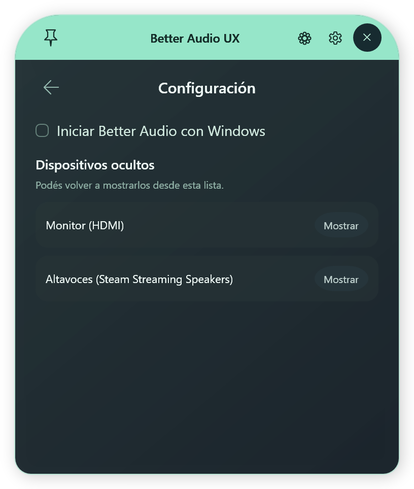

# Better Audio UX

A compact Windows 11 audio HUD that puts output devices and application volume one click away. It lives in the system tray and reduces the steps needed to switch between headphones and speakers, adjust volume, or mute an application.

Built with **C#, WPF, and .NET 10 LTS**. Current application release: **1.3.2**. The application interface is currently in Spanish; this documentation is in English.

**Resumen en español:** Better Audio UX es una herramienta portable para Windows 11 que permite cambiar la salida de audio, ajustar el volumen y silenciar aplicaciones desde un panel compacto en la bandeja del sistema. Incluye un carrusel de dispositivos, mezclador integrado, control de Windows Sonic y navegación con mouse y teclado, para reducir los clics necesarios en la configuración de Windows.

## Screenshots

| Output selector | Integrated mixer | Internal settings |
| --- | --- | --- |
|  |  |  |

Screenshots use demonstration data.

## Features

- Browse outputs in an animated arc, with **in use** and **available** status labels.
- Switch outputs automatically while browsing, or require a click or Enter to confirm.
- Hide unused outputs with **Ocultar** and restore them from internal **Configuración** (⚙). This only filters the app; it does not disable Windows endpoints.
- Enable or disable startup with Windows in internal settings. Startup launches silently in the tray; keep the portable app in its registered folder.
- Save a custom output order using **Ordenar** → **Posición**, placing frequently used devices next to each other. Reconnected devices retain their place; new devices appear at the end.
- Test the selected output with **Probar**, which plays a short chime without changing the Windows default output or its volume.
- Mirror one output to another with **Duplicar**, an independent copy-volume slider, and an active indicator.
- Adjust each output's volume and mute state.
- Control application audio sessions inside the same overlay.
- Enable Windows Sonic and open Windows settings for other spatial providers.
- Pin the panel to keep it open while working in another application.
- Position the HUD above its tray icon, respecting monitor boundaries and DPI.
- Smoothly expand and collapse between the main view and mixer, respecting Windows animation preferences.

## Download and run

Download the portable ZIP from [Releases](https://github.com/NicLen17/better-audio-ux/releases), extract it, and run **BetterAudio.exe**. Keep the other files beside the executable.

The **Windows x64** package includes the .NET runtime and requires neither a separate runtime installation nor administrator privileges. If Windows places the icon in the hidden-icons menu, drag it into the visible tray.

## Controls

| Action | Input |
| --- | --- |
| Preview without taking keyboard focus | Hover over the tray icon |
| Open with keyboard interaction | Click the tray icon |
| Browse outputs | Left / Right arrows, wheel over the arc, horizontal scroll, or side arrows |
| Confirm an output in manual mode | Click its bubble or press Enter |
| Adjust output volume | Slider, Up / Down arrows, or wheel over the volume control |
| Larger volume steps | Hold Shift for 10% steps instead of 2% |
| Mute output | Speaker button or M |
| Open integrated mixer | Mezclador section |
| Adjust an application | Drag its slider, or use Up / Down with its control focused |
| Browse mixer sessions | Wheel over the list; this scrolls without changing volume |
| Mute an application | Its speaker button, or M with its control focused |
| Return to outputs | Back arrow or Esc |
| Keep the panel open | Pin button in the header |
| Close the overlay | Close button, or Esc from the main view |
| Quit the application | Right-click tray icon, then Salir |

**Fijar al navegar** enables automatic switching and remembers your preference. In manual mode, browsing does not change the Windows default output. **En uso** identifies the actual active output; **Disponible** identifies an available alternative.

The mixer shows sessions for the selected output. One application can have multiple sessions. Master volume is visually separated from application controls. The header gear opens general audio settings; footer gears open the corresponding Windows settings.

## Duplicate audio

Choose **Duplicar** beside the output name, select **Origen** (for example, headphones) and **Repetir en** (speakers), then click **Activar duplicación**. The game or video must already play on the source output. Adjust **Volumen de la copia** independently and use **Detener duplicación** to stop sharing.

This shares all audio on the chosen source, including notifications and voice chat. The copy is stereo and may have some delay, particularly with Bluetooth. Both devices must remain connected and the destination must be audible. Surround sources are folded to stereo with front-channel levels preserved; only peaks that would exceed full scale are limited. The source and destination remain fixed when the Windows default changes. Closing the panel leaves the copy running; **Duplicar ●** on the main view indicates it is active. Disconnecting either endpoint or exiting Better Audio stops it. Reconnection and app restart require manual activation. Source and destination cannot be the same endpoint.

## Spatial audio

Enabling **Sonido espacial** selects **Windows Sonic**; disabling it turns spatial processing off. The application reads the native state again after a change. If the state cannot be determined, the toggle is disabled while settings remain accessible.

The gear opens output properties for Dolby/DTS and other available providers. Availability and licensing depend on Windows and your device. Enabling the toggle again selects Sonic even if another provider was previously configured. Unsupported devices may reject the change; the HUD reports the failure and retains the observed state.

## Build from source

Requires Windows and the **.NET 10 SDK**.

```powershell
# Publish a portable x64 build
.\build.ps1

# Run regression tests and create a ZIP
.\build.ps1 -Test -Package

# Also run integration checks against local Windows audio
.\build.ps1 -Test -Live -Package
```

Quit the running application before publishing. Output is written to `artifacts/BetterAudio/`; the ZIP is `artifacts/BetterAudio-win-x64.zip`. You can also open `BetterAudio.slnx` in a .NET 10 compatible development environment.

GitHub Actions builds, tests, and publishes a portable artifact on Windows. See the [development guide](docs/DEVELOPMENT.md) for test modes and implementation details.

## Architecture

- **Core/Audio:** Core Audio endpoints, sessions, and output switching; COM objects stay on a dedicated thread.
- **Core/Models:** Device and session snapshots.
- **UI/Flyout:** HUD, carousel, animations, and input controls.
- **UI/ViewModels:** Reactive state and coalesced volume writes.
- **Services:** Win32 tray integration, positioning, preferences, and diagnostics.
- **AudioFlyoutApp.Tests:** Behavior, layout, animation, and integration checks.

## Scope and limitations

- Portable, unsigned application without an installer or automatic updater.
- Output switching uses the undocumented Windows `IPolicyConfig` interface, which may need changes in future Windows versions.
- Microphone controls and per-application output routing are not included. Applications with explicitly assigned outputs may retain those assignments.
- Physical Bluetooth/USB reconnection and mixed-monitor/DPI setups need testing on the relevant hardware.
- Application icons fall back to a generic icon when Windows cannot provide them.

## Privacy and troubleshooting

No accounts, application telemetry, or remote services. Preferences and rotating logs are stored locally under `%LOCALAPPDATA%\BetterAudio`. Windows startup is opt-in through internal settings. Output order, hidden outputs and navigation preferences save immediately to `settings.json`, independently of the executable folder. Saves are atomic and keep a previous valid configuration in `settings.json.bak` for recovery. Rebuilding or replacing the portable app preserves these files.

To report a problem, [open an issue](https://github.com/NicLen17/better-audio-ux/issues) with your Windows version, reproduction steps, and expected behavior. Review logs before sharing them.

## Dependencies and distribution

Uses NAudio.Wasapi/NAudio.Core (MIT), the .NET runtime, and **SoundVolumeCommandLine 1.28** by Nir Sofer for spatial-audio changes.

**The NirSoft component is freeware with restrictions:** free redistribution requires all original files, and sale or inclusion in a commercial product is prohibited. The package preserves the originals and verifies the executable hash during builds. A commercial distribution would require replacing that backend or obtaining permission from its author.

See [THIRD-PARTY-NOTICES.md](THIRD-PARTY-NOTICES.md) and the [original NirSoft readme](ThirdParty/SoundVolumeCommandLine/readme.txt). Dependency licenses do not grant a license to this project's own code.
