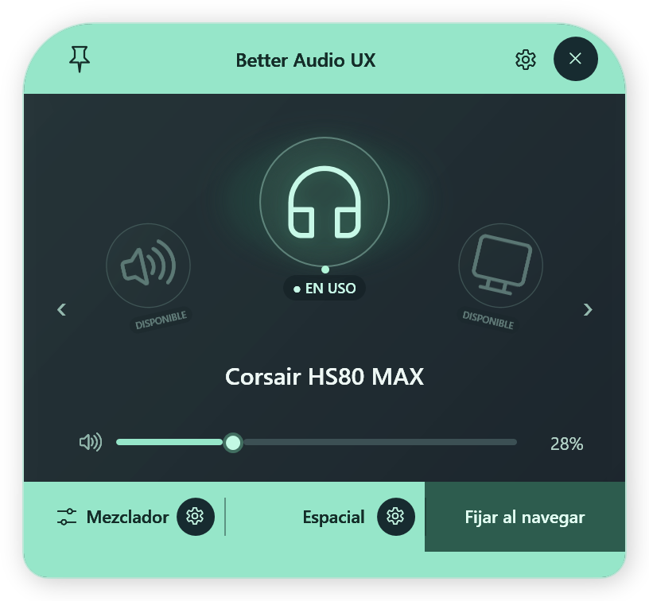
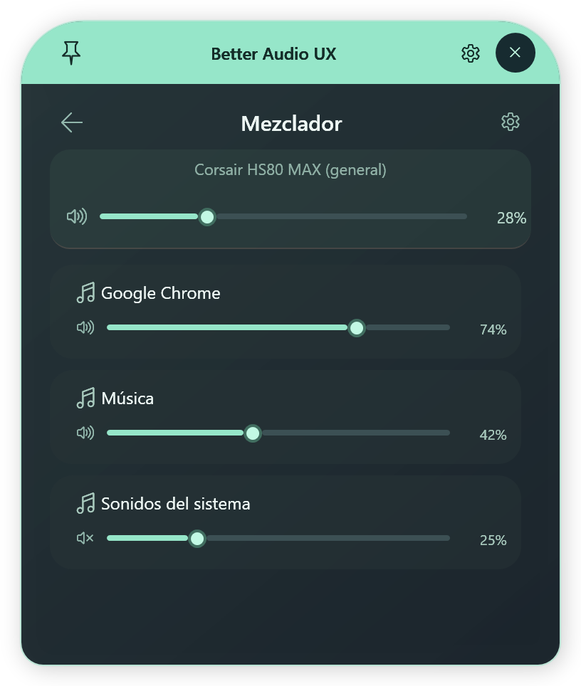

# Better Audio UX

Un pequeño HUD para Windows 11 que pone tus salidas de audio y el volumen de tus aplicaciones a un clic de distancia.

Better Audio UX vive en la bandeja del sistema. Su objetivo es reducir los pasos necesarios para cambiar de auriculares a altavoces, ajustar el volumen o silenciar una aplicación, manteniendo una interfaz compacta y accesible con mouse y teclado.

Es un side project de escritorio desarrollado con **C#, WPF y .NET 10 LTS**. Versión actual: **1.2.3**.

## Así se ve

| Dispositivos | Mezclador integrado |
| --- | --- |
|  |  |

Las imágenes muestran datos de demostración.

## Qué podés hacer

- Recorrer tus dispositivos mediante un carrusel en arco y ver cuál está **en uso** o **disponible**.
- Activar una salida al navegar, o deshabilitar esa opción para confirmar con clic o Enter.
- Ajustar volumen y silencio de cada salida.
- Abrir un mezclador de aplicaciones dentro del mismo HUD, sin pasar por Configuración.
- Activar Windows Sonic desde un checkbox y acceder a los proveedores espaciales de Windows.
- Fijar el panel para mantenerlo abierto mientras usás otra aplicación.
- Usarlo en distintos monitores, con posicionamiento sobre el icono de bandeja y ajuste a los límites de pantalla.

## Descargar y ejecutar

Descargá el ZIP portable desde [Releases](https://github.com/NicLen17/better-audio-ux/releases), extraelo y ejecutá **BetterAudio.exe**. Conservá los demás archivos junto al ejecutable.

La publicación para **Windows x64** incluye el runtime de .NET: no requiere instalarlo ni ejecutar como administrador. Si el icono aparece en el menú de iconos ocultos junto al reloj, podés arrastrarlo a la bandeja visible.

## Controles

| Acción | Cómo |
| --- | --- |
| Vista previa | Hover sobre el icono de bandeja |
| Abrir con teclado | Clic en el icono |
| Recorrer salidas | ← / →, rueda sobre el arco o botones laterales |
| Confirmar una salida en modo manual | Clic en su burbuja o Enter |
| Ajustar volumen de salida | Slider o ↑ / ↓; rueda sobre el volumen |
| Ajuste rápido | Shift para pasos de 10% en lugar de 2% |
| Silenciar salida | Botón de altavoz o M |
| Abrir mezclador integrado | Botón Mezclador |
| Ajustar una aplicación | Arrastrar su slider; ↑ / ↓ con su control enfocado |
| Explorar la lista del mezclador | Rueda: desplaza la lista sin cambiar volumen |
| Volver a dispositivos | Flecha de regreso o Esc |
| Mantener abierto | Botón de fijar en el encabezado |
| Cerrar overlay | Cruz; Esc desde la vista principal |
| Salir de la app | Clic derecho en el icono → Salir |

**Activar al navegar** viene habilitado y recuerda tu preferencia. En modo manual, recorrer salidas no cambia el audio. El estado **En uso** indica la salida real de Windows.

El mezclador muestra las sesiones de la salida seleccionada; una aplicación puede tener varias sesiones. El volumen general permanece separado de los controles por aplicación. Los engranajes abren las opciones correspondientes de Windows.

## Sonido espacial

Marcar el checkbox selecciona **Windows Sonic**; desmarcarlo desactiva el procesamiento espacial. El programa consulta el estado nativo después de escribirlo. Si no puede obtener el estado, deshabilita el checkbox y conserva el acceso a configuración.

El engranaje permite elegir Dolby/DTS y otros proveedores disponibles. Sus licencias y compatibilidad dependen de Windows y del dispositivo. Volver a marcar el checkbox selecciona Sonic, aunque antes se hubiera usado otro proveedor.

## Compilar desde el código

Requiere Windows y el **SDK de .NET 10**.

```powershell
# Publicación portable x64
.\build.ps1

# Pruebas, integración con Windows y ZIP
.\build.ps1 -Test -Live -Package
```

Cerrá la app desde su menú de bandeja antes de publicar. El resultado queda en `artifacts/BetterAudio/` y el ZIP en `artifacts/BetterAudio-win-x64.zip`.

También podés abrir `BetterAudio.slnx` en un entorno compatible con .NET 10. El workflow de GitHub Actions compila y ejecuta las pruebas en Windows.

## Arquitectura

- **Core/Audio:** Core Audio, sesiones del mezclador y cambios de salida; objetos COM confinados a un hilo dedicado.
- **Core/Models:** snapshots de dispositivos y sesiones.
- **UI/Flyout:** HUD, carrusel, animaciones y controles.
- **UI/ViewModels:** estado reactivo y escrituras de volumen agrupadas.
- **Services:** bandeja Win32, posicionamiento, preferencias y diagnóstico.
- **AudioFlyoutApp.Tests:** pruebas de comportamiento, layout e integración.

Más detalles en [la guía de desarrollo](docs/DEVELOPMENT.md).

## Alcance y limitaciones

- Aplicación portable sin firma de distribución, instalador ni actualizador automático.
- El cambio de salida utiliza `IPolicyConfig`, una interfaz de Windows no documentada que puede requerir ajustes en versiones futuras.
- No incluye control de micrófonos ni redirección de salida por aplicación. Las aplicaciones con una salida fijada pueden mantener esa asignación.
- La reconexión física Bluetooth/USB y combinaciones de monitores/DPI necesitan pruebas en cada equipo.
- Los iconos de aplicaciones usan un reemplazo genérico cuando Windows no permite obtenerlos.

## Privacidad y diagnóstico

Sin cuentas, telemetría propia ni servicios remotos. Las preferencias y logs rotativos se guardan localmente en `%LOCALAPPDATA%\BetterAudio`. La aplicación no se agrega automáticamente al inicio de Windows.

Para reportar un problema, abrí un [issue](https://github.com/NicLen17/better-audio-ux/issues) con tu versión de Windows, los pasos para reproducirlo y el comportamiento esperado. Revisá cualquier log antes de compartirlo.

## Dependencias y distribución

Utiliza NAudio.Wasapi/NAudio.Core (MIT), el runtime de .NET y **SoundVolumeCommandLine 1.28**, de Nir Sofer, para configurar sonido espacial.

**El componente de NirSoft es freeware con restricciones:** permite redistribución gratuita con todos sus archivos originales, pero prohíbe venderlo o incluirlo en un producto comercial. El paquete conserva los originales y verifica su hash al compilar. Antes de una distribución comercial, es necesario sustituir ese backend u obtener autorización del titular.

Consultá [THIRD-PARTY-NOTICES.md](THIRD-PARTY-NOTICES.md) y el [readme original de NirSoft](ThirdParty/SoundVolumeCommandLine/readme.txt). Las licencias de las dependencias no conceden una licencia sobre el código propio del proyecto.

## Interfaz compacta 1.2.7

El footer se divide en tres secciones: Mezclador, Espacial y Fijar al navegar. Las opciones activas colorean su sección completa, sin casillas; los engranajes siguen abriendo sus ajustes de Windows. Las tres secciones del footer conservan sus bordes rectos, con una base decorativa independiente que redondea el borde inferior sin recortar los botones. Los engranajes están más cerca del texto. El encabezado conserva sus esquinas superiores redondeadas. Los engranajes tienen contenedores circulares con contraste, que invierten sus colores cuando Espacial está activo. La apertura prepara el audio antes de mostrar un único fundido del contenido, sin volver a escalar ni cambiar la opacidad de la ventana. Los indicadores de estado de los dispositivos ("EN USO" y "DISPONIBLE") cuentan con mayor visibilidad, fondo y tipografía destacada. La vista principal mide 408 × 378 DIPs.

